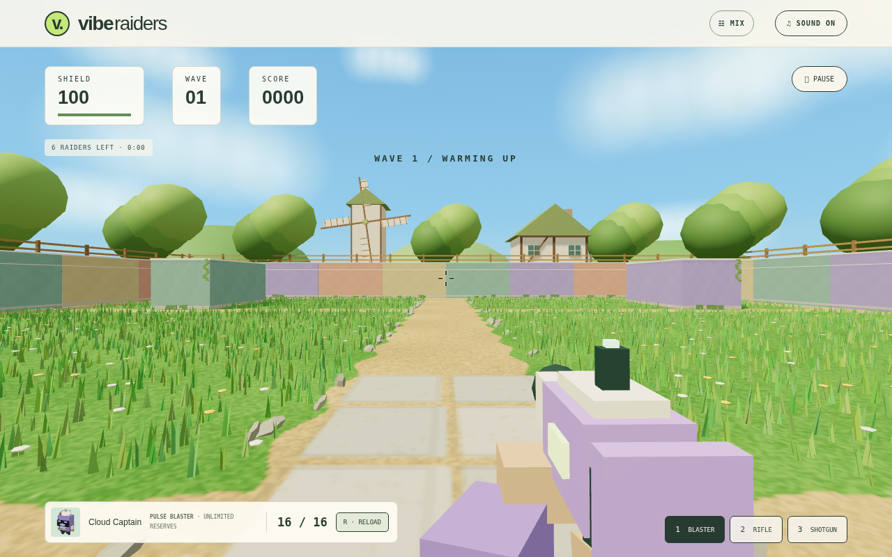
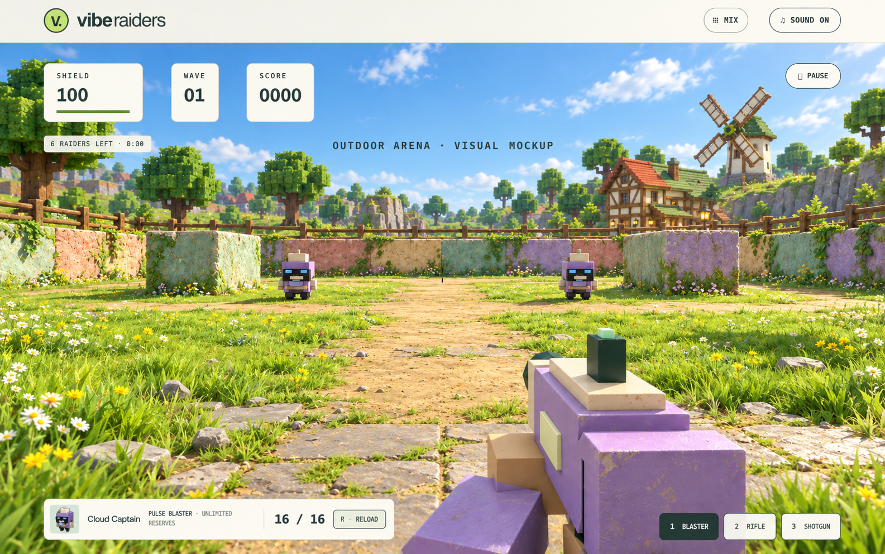

# Outdoor arena design

## Implemented arena

This screenshot shows the actual WebGL game implementation: grass, flowers, dirt paths, entry paving, pastel cover, ivy, trees, timber fencing, village scenery, and a moving windmill. First-person gameplay and the original collision/cover layout are preserved. Wave difficulty now increases progressively.

## Approved visual target

This generated concept image guided the scenery. The running game is a procedural interpretation, not a pixel-identical rendering of the concept image.
